<picture>
  <source media="(prefers-color-scheme: dark)" srcset="assets/v3/hero-dark.svg">
  
</picture>

<p align="center">
  <a href="https://cv.143.lat"><code>cv</code></a> &nbsp;
  <a href="https://deepanshulathar.com"><code>portfolio</code></a> &nbsp;
  <a href="https://linkedin.com/in/deepanshulathar"><code>linkedin</code></a> &nbsp;
  <a href="mailto:deepanshu@143.lat"><code>deepanshu@143.lat</code></a>
</p>

<br>

<picture>
  <source media="(prefers-color-scheme: dark)" srcset="assets/v3/s1-dark.svg">
  
</picture>

<a href="https://gapl.143.lat"><picture>
  <source media="(prefers-color-scheme: dark)" srcset="assets/v3/gapl-dark.svg">
  
</picture></a>

<p align="right"><sub>proof → <a href="https://github.com/latharrr/gapl/blob/master/evals/EVAL_REPORT.md">eval report</a> · <a href="https://github.com/latharrr/gapl">repo</a> · <a href="https://gapl.143.lat">live</a></sub></p>

<a href="https://proofmart.shop"><picture>
  <source media="(prefers-color-scheme: dark)" srcset="assets/v3/proofmart-dark.svg">
  
</picture></a>

<p align="right"><sub>proof → <a href="https://github.com/latharrr/Proofmart.shop/tree/main/web/tests">28 unit + 4 E2E test files</a> · <a href="https://github.com/latharrr/Proofmart.shop">repo</a> · <a href="https://proofmart.shop">live</a></sub></p>

<a href="https://tv.143.lat"><picture>
  <source media="(prefers-color-scheme: dark)" srcset="assets/v3/lpuconnect-dark.svg">
  
</picture></a>

<p align="right"><sub>proof → <a href="https://github.com/latharrr/lpuconnect/blob/main/docs/LOADTEST.md">load test report</a> · <a href="https://github.com/latharrr/lpuconnect/tree/main/backend/test">47 backend tests</a> · <a href="https://tv.143.lat">live</a></sub></p>

<a href="https://dandiya.picapool.tech"><picture>
  <source media="(prefers-color-scheme: dark)" srcset="assets/v3/dandiya-dark.svg">
  
</picture></a>

<p align="right"><sub>proof → <a href="https://dandiya.picapool.tech">live closing page</a> · private repo, walkthrough on request</sub></p>

<br>

<picture>
  <source media="(prefers-color-scheme: dark)" srcset="assets/v3/s2-dark.svg">
  
</picture>

<picture>
  <source media="(prefers-color-scheme: dark)" srcset="assets/v3/changelog-dark.svg">
  
</picture>

<p align="right"><sub>company metrics come from internal dashboards and are on my <a href="https://cv.143.lat">CV</a> · happy to walk through how each was measured</sub></p>

<br>

<picture>
  <source media="(prefers-color-scheme: dark)" srcset="assets/v3/s3-dark.svg">
  
</picture>

<p align="center">
  
</p>

```yaml
product:   user research, prioritisation, GTM, funnels & cohorts, retention, A/B tests, attribution
ai:        Claude, OpenAI, Gemini, Groq, RAG on pgvector, multi-provider failover, output validation, evals

defaults:
  start_with:    user behaviour, not a feature list
  before_launch: instrument the funnel, or it didn't happen
  ai_features:   fallback providers, validated output, an eval set
  trust:         signed outputs, verified webhooks, least-privilege queries
  done_means:    deployed, measured, and someone actually used it
```

<br>

<picture>
  <source media="(prefers-color-scheme: dark)" srcset="assets/v3/s4-dark.svg">
  
</picture>

| | issue | label |
|:-:|---|---|
| 🟢 | Asks *"how will we measure this?"* before the first line of code | `wontfix` |
| 🟢 | Builds an internal tool when a spreadsheet would have done | `works as intended` |
| 🟢 | Ships the eval set before the demo | `feature` |
| 🟣 | Still a student until 2028 | `closed in v5.0` |

<br>

<a href="mailto:deepanshu@143.lat"><picture>
  <source media="(prefers-color-scheme: dark)" srcset="assets/v3/roadmap-dark.svg">
  
</picture></a>

<p align="center"><sub>B.Tech CSE · Lovely Professional University · 2024 to 2028 · CGPA 7.15 · McKinsey Forward · Deloitte Data Analytics Simulation</sub></p>
