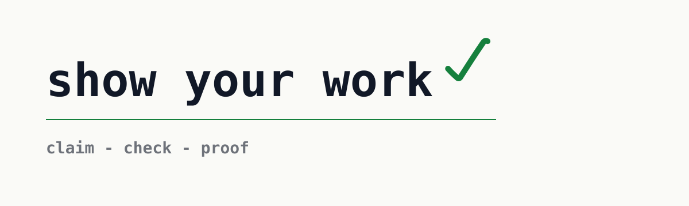

# Deepanshu Lathar

Full-stack & AI engineer at PicaPool.

I build products that show their work.

<picture>
  <source media="(prefers-color-scheme: dark)" srcset="art/hero-dark.svg">
  
</picture>

[Website](https://deepanshulathar.com/) · [Writing](https://deepanshulathar.com/sidequests) · [LinkedIn](https://www.linkedin.com/in/deepanshulathar/) · [Résumé](https://deepanshulathar.com/Deepanshu-Lathar-Resume.pdf) · [Email](mailto:deepanshulathar@gmail.com)

Open to Summer 2027 internships.

## The proof

Each project below makes one claim. Each claim comes with the check that backs it.

### [Gapl](https://gapl.143.lat/) - [repo](https://github.com/latharrr/gapl) - live beta, about 10 early users

Job seekers cannot tell if a resume will pass a recruiter's screen. Gapl scores it against a job description, lists the gaps, builds a learning roadmap, and helps rewrite the CV.

Check: an offline harness of 44 synthetic documents (27 resumes, 17 non-resumes) caught a bug where genuine resumes mentioning invoice or receipt projects were rejected as non-resumes. After the fix it went from 41/44 to 44/44. Synthetic pipeline tests, not a claim of real-world AI accuracy. Report: [evals/EVAL_REPORT.md](https://github.com/latharrr/gapl/blob/master/evals/EVAL_REPORT.md).

Built with: Next.js, TypeScript, Firebase. One AI gateway with a primary model, a backup, and cost tracked per call. I built Gapl Claude-assisted: I owned the problem, product flow, and features, and used Claude to build and iterate.

### [ProofMart](https://proofmart.shop/) - [repo](https://github.com/latharrr/Proofmart.shop) - live beta, in use at one company

Bank statements lie by arithmetic, and nobody re-adds the rows. ProofMart checks a PDF statement by re-adding its own numbers, and pins each finding to the page with the sum that proves it.

Check: verdicts come from fixed rules in a fixed order - `INCONCLUSIVE`, `FAIL`, `REVIEW`, `CLEAR`. A rule without enough columns reports "insufficient data". Dossiers are Ed25519-signed, and anyone can verify one with no account.

Built with: Next.js, TypeScript, Supabase.

Real screenshot from ProofMart: synthetic statement generated by the repo's own test fixtures.

### [LpuTV](https://lputv.vercel.app/) - [repo](https://github.com/latharrr/lpuconnect) - live

Anonymous ten-minute text chat for LPU students. Extending a chat or becoming friends needs both people to agree, and the server checks it.

Check: one test asserts message text is never written to the database.

Built with: Express, Socket.IO, WebRTC, SQLite.

### [LinkedIn drafting bot](https://github.com/latharrr/linkedin-bot) - public repo

Drafting posts is easy. Posting a claim you cannot back up is the risk. This Telegram-controlled bot drafts and schedules posts, and a deterministic grounding gate holds back drafts with claims about me that nothing backs up.

Check: a draft with a `[verify]` tag cannot be scheduled.

Built with: Python.

### [WhatsApp AI receptionist](https://deepanshulathar.com/labs/whatsapp-receptionist) - personal, single-business demo I built and run. Live.

Check: this is a personal demo, not a product launch. The multi-tenant receptionist product is still a pilot.

## At PicaPool

I take briefs to polished, shipped products, often by end of day. I think from user intent and behaviour, not feature count.

In 8 weeks I shipped 15+ internal tools over a 79-table production schema. One was an AST-validated LLM-SQL analytics workflow. Read-only queries were the guardrail. Another was a Telegram RAG bot.

## Tools I reach for

AI & Product: Claude, OpenAI, Groq, Gemini, prompt engineering, RAG, AI evaluation.

Frontend: TypeScript, React, Next.js, Tailwind.

Backend & Data: Python, Node.js, Firebase / Firestore, PostgreSQL, Supabase.

Tools: Git, Vercel, Playwright, Vitest.

## Recent commits

Updated daily from the GitHub API, latest commit per project.

- `13 Nov` **Gapl**: [Fix upload gate false-rejecting billing-domain resumes; add offline eval harness](https://github.com/latharrr/gapl/commit/381b395740ce3e7556ed045cb455b785c26e05fe)
- `13 Nov` **linkedin-bot**: [Document safe setup, paused deployment and restore workflow](https://github.com/latharrr/linkedin-bot/commit/01f5bb9bac5790becfb37a1db536a0beb67df472)
- `08 Nov` **LpuTV**: [Add a Support me link to the landing footer](https://github.com/latharrr/lpuconnect/commit/dd43130a02d10629fdd6082a65396483966c0721)
- `26 Oct` **ProofMart**: [docs: replace role row with scope](https://github.com/latharrr/Proofmart.shop/commit/289ae5f8ea008e9ea1fec30099459b3aa71c7e6e)

Open to Summer 2027 internships
