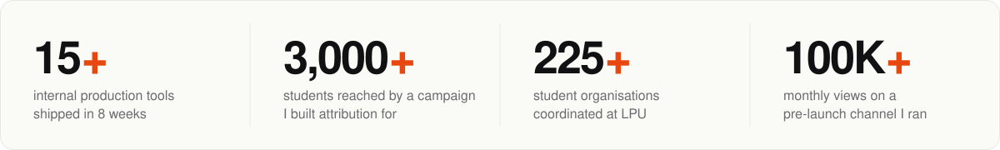
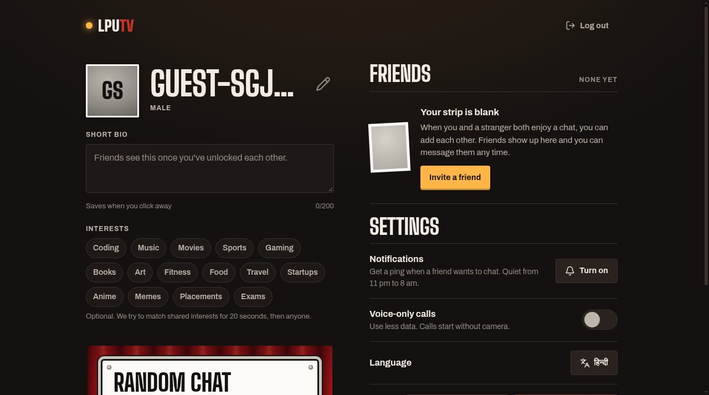
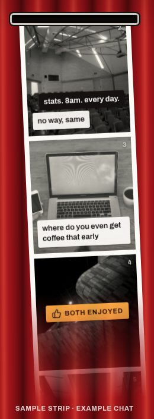
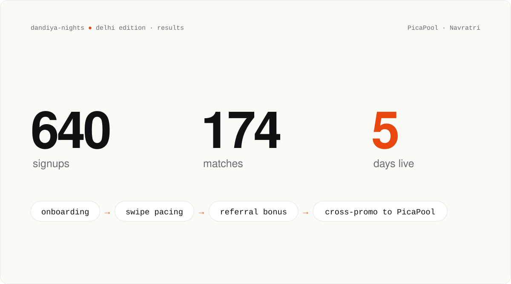

<picture>
  <source media="(prefers-color-scheme: dark)" srcset="assets/header-dark.svg">
  
</picture>

<p align="center">
  <a href="https://deepanshulathar.com"><b>Portfolio</b></a> &nbsp;·&nbsp;
  <a href="https://cv.143.lat"><b>CV</b></a> &nbsp;·&nbsp;
  <a href="https://linkedin.com/in/deepanshulathar"><b>LinkedIn</b></a> &nbsp;·&nbsp;
  <a href="mailto:deepanshu@143.lat"><b>deepanshu@143.lat</b></a>
</p>

> **30-second version.** B.Tech CSE student at LPU who works in founders' offices and writes the code himself. Shipped 15+ internal tools in 8 weeks, built attribution for a 3,000+ student campaign, and runs three live products end to end. Looking for an **AI PM / product internship, on-site in Bengaluru, Jan to Jun 2027.**

<p align="center">
  
</p>

<picture>
  <source media="(prefers-color-scheme: dark)" srcset="assets/stats-dark.svg">
  
</picture>

<br><br>

<picture>
  <source media="(prefers-color-scheme: dark)" srcset="assets/s01-dark.svg">
  
</picture>

### Gapl &nbsp;·&nbsp; see your resume the way a recruiter does
<sub>[**Live beta**](https://gapl.143.lat) &nbsp;·&nbsp; [Sample report](https://gapl.vercel.app/demo) &nbsp;·&nbsp; [Repo](https://github.com/latharrr/gapl) &nbsp;·&nbsp; `Next.js` `TypeScript` `Firebase` `Razorpay`</sub>


Upload a resume and a job description. Gapl scores readiness and ATS fit, points to the line that sank it, simulates the recruiter's verdict, and builds a project roadmap to close the gap.

- **One LLM gateway** with provider fallback and output validation behind every feature
- **44-document eval harness** caught a false-rejection bug: 41/44 → 44/44 (synthetic pipeline tests)
- **Live beta, 10+ testers.** HMAC-verified billing, attribution from email open to paid conversion

<br>

### ProofMart &nbsp;·&nbsp; bank statements, re-added
<sub>[**Live beta**](https://proofmart.shop) &nbsp;·&nbsp; [Repo](https://github.com/latharrr/Proofmart.shop) &nbsp;·&nbsp; `Next.js` `TypeScript` `Supabase` `OCR`</sub>


Statements lie by arithmetic and nobody re-adds the rows. ProofMart does: upload → classify → extract → OCR → verify, with every finding pinned to page coordinates so each verdict can be checked.

- **No AI in the verdict path.** Six deterministic markers, fixed verdict order: `INCONCLUSIVE` `FAIL` `REVIEW` `CLEAR`
- **Ed25519-signed dossiers** anyone can verify without an account; public API and Node CLI
- **15 Vitest suites, 4 Playwright E2E specs**, row-level security, HMAC webhooks

<br>

### LPU Connect &nbsp;·&nbsp; anonymous chat that stays anonymous
<sub>[**Live**](https://tv.143.lat) &nbsp;·&nbsp; [Repo](https://github.com/latharrr/lpuconnect) &nbsp;·&nbsp; `React` `Node.js` `Socket.IO` `WebRTC` `SQLite`</sub>

<table>
<tr>
<td width="78%"></td>
<td width="22%"></td>
</tr>
</table>

Ten-minute chats with a random LPU student. Video unlocks only if both want it; names only after a mutual friend accept. The server enforces every step, not just the UI.

- **Proven private:** a test scans the database to prove message text is never stored
- **47 backend tests, ~84% line coverage;** a load test ran 10,000 simulated users with zero failures
- **Hardened:** rate limiting, CORS lockdown, XSS sanitisation

<br>

### Dandiya Nights &nbsp;·&nbsp; PicaPool's Navratri partner-matching app
<sub>Built at PicaPool · consumer event web app · Delhi edition</sub>

<picture>
  <source media="(prefers-color-scheme: dark)" srcset="assets/dandiya-dark.svg">
  
</picture>

I owned the product end to end: onboarding, a swipe-pacing economy with referral bonuses, and privacy-first cross-promotion into the PicaPool app.

- **Tracked the activation funnel daily** (visitor → OTP → profile) while it was live
- **The product side of the job:** growth mechanics, funnels and retention, not just code

<sub>Also built: [LinkedIn autopilot](https://github.com/latharrr/linkedin-bot) (Telegram brief → researched drafts → approved post) · [Spraykart](https://github.com/latharrr/spraykart) (Shopify storefront for a D2C client)</sub>

<br><br>

<picture>
  <source media="(prefers-color-scheme: dark)" srcset="assets/s02-dark.svg">
  
</picture>

| Where | Role | What changed because I was there |
|---|---|---|
| **PicaPool** <br><sub>Delhi · Jul 2025 to present</sub> | Founder's Office | Shipped **15+ internal tools in 8 weeks**: CRM with role-based access, WhatsApp Business API dashboard, campaign attribution, merchant onboarding. Replaced download counts with deduplicated event attribution for a campaign reaching **3,000+ students**. Built a natural-language analytics assistant whose SQL is locked to read-only. |
| **UniLyf** <br><sub>UK, remote · Jan to May 2026</sub> | Product & Growth, Founder's Office | Instrumented a 0-to-1 beta and found the actions tied to Day-7 retention, then turned it into the launch plan. Led a team of 6. Grew the pre-launch Instagram to **100K+ monthly views**. |
| **LPU, Student Organisations** <br><sub>Mar 2025 to present</sub> | Event → HR Coordinator | Promoted in 4 months. Coordinates **225+ student organisations**; ran **30+ large campus events**. |
| **Freelance** <br><sub>Jun 2025 to Feb 2026</sub> | Web & Growth | Paid D2C work: Shopify storefront for Spraykart LLP, SEO and lead generation for an accountancy practice, other site builds. |

<br>

<picture>
  <source media="(prefers-color-scheme: dark)" srcset="assets/s03-dark.svg">
  
</picture>

```yaml
start_with:    user behaviour, not a feature list
before_launch: instrument the funnel, or it didn't happen
ai_features:   fallback providers, validated output, an eval set
trust:         signed outputs, verified webhooks, least-privilege queries
done_means:    deployed, measured, and someone actually used it
```

<br>

<picture>
  <source media="(prefers-color-scheme: dark)" srcset="assets/s04-dark.svg">
  
</picture>

**Product** &nbsp; user research · prioritisation · GTM · funnels & cohorts · retention · A/B tests · attribution · UX copy<br>
**AI** &nbsp; Claude · OpenAI · Gemini · Groq · prompt engineering · RAG with pgvector · multi-provider failover · output validation · n8n · Claude Code · Cursor<br>
**Engineering** &nbsp; TypeScript · Python · SQL · Next.js · React · Node.js · FastAPI · Postgres · Supabase · Firebase · Socket.IO · WebRTC · Docker · CI/CD · Vitest · Playwright

<br>

<p align="center">
  <b>B.Tech CSE, Lovely Professional University</b> · 2024 to 2028 · CGPA 7.15<br>
  <sub>McKinsey Forward Program · Deloitte Data Analytics Simulation · Scaler Young Innovator Internship Challenge · LPU Summer Training in AI</sub>
  <br><br>
  <a href="mailto:deepanshu@143.lat"><b>Hiring for Jan to Jun 2027? Say hi →</b></a>
</p>
