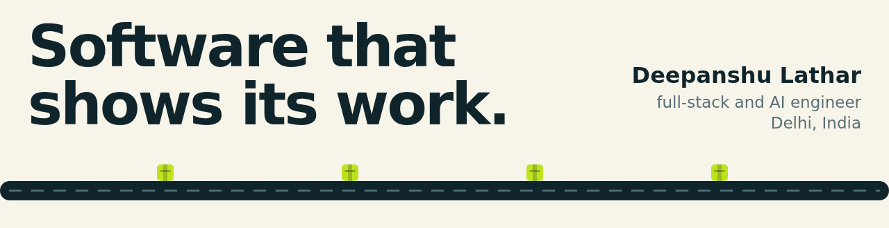
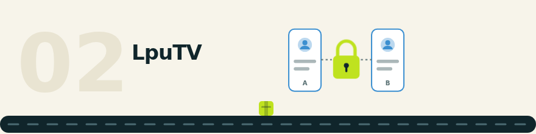
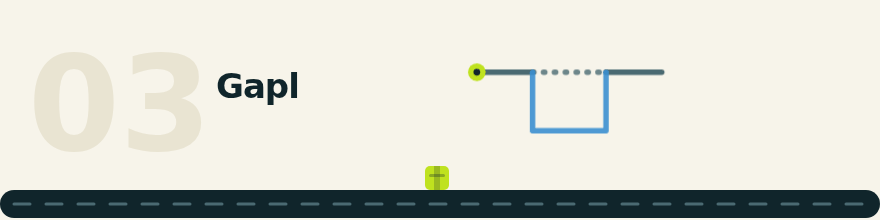

<picture>
  <source media="(prefers-reduced-motion: reduce) and (prefers-color-scheme: dark) and (max-width: 640px)" srcset="art/still/hero-mobile-dark.svg">
  <source media="(prefers-reduced-motion: reduce) and (prefers-color-scheme: dark)" srcset="art/still/hero-dark.svg">
  <source media="(prefers-reduced-motion: reduce) and (max-width: 640px)" srcset="art/still/hero-mobile-light.svg">
  <source media="(prefers-reduced-motion: reduce)" srcset="art/still/hero-light.svg">
  <source media="(prefers-color-scheme: dark) and (max-width: 640px)" srcset="art/anim/hero-mobile-dark.gif">
  <source media="(prefers-color-scheme: dark)" srcset="art/anim/hero-dark.gif">
  <source media="(max-width: 640px)" srcset="art/anim/hero-mobile-light.gif">
  
</picture>

[Website](https://deepanshulathar.com) · [Writing](https://deepanshulathar.com/sidequests) · [LinkedIn](https://www.linkedin.com/in/deepanshulathar/) · [Résumé](https://deepanshulathar.com/Deepanshu-Lathar-Resume.pdf) · [Email](mailto:deepanshulathar@gmail.com)

<picture>
  <source media="(prefers-reduced-motion: reduce) and (prefers-color-scheme: dark) and (max-width: 640px)" srcset="art/still/s1-mobile-dark.svg">
  <source media="(prefers-reduced-motion: reduce) and (prefers-color-scheme: dark)" srcset="art/still/s1-dark.svg">
  <source media="(prefers-reduced-motion: reduce) and (max-width: 640px)" srcset="art/still/s1-mobile-light.svg">
  <source media="(prefers-reduced-motion: reduce)" srcset="art/still/s1-light.svg">
  <source media="(prefers-color-scheme: dark) and (max-width: 640px)" srcset="art/anim/s1-mobile-dark.gif">
  <source media="(prefers-color-scheme: dark)" srcset="art/anim/s1-dark.gif">
  <source media="(max-width: 640px)" srcset="art/anim/s1-mobile-light.gif">
  
</picture>

**[ProofMart](https://proofmart.shop)** · live beta · [repo](https://github.com/latharrr/Proofmart.shop) 
Checks PDF bank statements by re-adding the rows. Verdicts come from fixed rules, and each finding is pinned to a place on the page with the sum that proves it. Next.js, TypeScript, Supabase. 
Illustration of the idea, not live output.

<picture>
  <source media="(prefers-reduced-motion: reduce) and (prefers-color-scheme: dark) and (max-width: 640px)" srcset="art/still/s2-mobile-dark.svg">
  <source media="(prefers-reduced-motion: reduce) and (prefers-color-scheme: dark)" srcset="art/still/s2-dark.svg">
  <source media="(prefers-reduced-motion: reduce) and (max-width: 640px)" srcset="art/still/s2-mobile-light.svg">
  <source media="(prefers-reduced-motion: reduce)" srcset="art/still/s2-light.svg">
  <source media="(prefers-color-scheme: dark) and (max-width: 640px)" srcset="art/anim/s2-mobile-dark.gif">
  <source media="(prefers-color-scheme: dark)" srcset="art/anim/s2-dark.gif">
  <source media="(max-width: 640px)" srcset="art/anim/s2-mobile-light.gif">
  
</picture>

**[LpuTV](https://lputv.vercel.app)** · live · [repo](https://github.com/latharrr/lpuconnect) 
Anonymous ten-minute text chat for LPU students. Extending a chat or becoming friends needs both people to agree, and the server checks it. A test asserts message text is never written to the database. Express, Socket.IO, WebRTC, SQLite. 
Illustration of the idea, not live output.

<picture>
  <source media="(prefers-reduced-motion: reduce) and (prefers-color-scheme: dark) and (max-width: 640px)" srcset="art/still/s3-mobile-dark.svg">
  <source media="(prefers-reduced-motion: reduce) and (prefers-color-scheme: dark)" srcset="art/still/s3-dark.svg">
  <source media="(prefers-reduced-motion: reduce) and (max-width: 640px)" srcset="art/still/s3-mobile-light.svg">
  <source media="(prefers-reduced-motion: reduce)" srcset="art/still/s3-light.svg">
  <source media="(prefers-color-scheme: dark) and (max-width: 640px)" srcset="art/anim/s3-mobile-dark.gif">
  <source media="(prefers-color-scheme: dark)" srcset="art/anim/s3-dark.gif">
  <source media="(max-width: 640px)" srcset="art/anim/s3-mobile-light.gif">
  
</picture>

**[Gapl](https://gapl.vercel.app)** · pre-launch demo · [repo](https://github.com/latharrr/gapl) 
Simulates a recruiter's screen of a resume against a target role, then builds a roadmap for the gaps. User-facing AI tasks run through one gateway that falls back to a backup model and tracks cost per call. Next.js, Firebase, Anthropic. 
Illustration of the idea, not live output.

<picture>
  <source media="(prefers-reduced-motion: reduce) and (prefers-color-scheme: dark) and (max-width: 640px)" srcset="art/still/s4-mobile-dark.svg">
  <source media="(prefers-reduced-motion: reduce) and (prefers-color-scheme: dark)" srcset="art/still/s4-dark.svg">
  <source media="(prefers-reduced-motion: reduce) and (max-width: 640px)" srcset="art/still/s4-mobile-light.svg">
  <source media="(prefers-reduced-motion: reduce)" srcset="art/still/s4-light.svg">
  <source media="(prefers-color-scheme: dark) and (max-width: 640px)" srcset="art/anim/s4-mobile-dark.gif">
  <source media="(prefers-color-scheme: dark)" srcset="art/anim/s4-dark.gif">
  <source media="(max-width: 640px)" srcset="art/anim/s4-mobile-light.gif">
  
</picture>

**[LinkedIn drafting bot](https://github.com/latharrr/linkedin-bot)** · public repo 
A Telegram-controlled assistant for drafting and scheduling posts. A deterministic grounding gate checks drafts for claims about me that nothing backs up and holds back the ones that fail. Python. 
Illustration of the idea, not live output.

Also: [Deepanshu Labs](https://deepanshulathar.com/labs/whatsapp-receptionist) (live WhatsApp receptionist).

<b>How each one decides</b>

- **ProofMart:** rules run over the page's own numbers and the verdict is picked in a fixed order: `INCONCLUSIVE`, `FAIL`, `REVIEW`, `CLEAR`. A rule without enough columns reports "insufficient data". Dossier PDFs carry an Ed25519 signature, and the verification endpoint is public and needs no account.
- **LpuTV:** the server holds each chat's consent state, so the two-sided steps (extending a chat, becoming friends) are checked there, with tests behind it.
- **Gapl:** one gateway runs the user-facing AI tasks, tries a backup model when the primary fails and records cost per call.
- **LinkedIn bot:** a deterministic gate checks drafts for lines lifted from my profile, repeated stories and numbers about me that nothing backs. A draft with a `[verify]` tag cannot be scheduled.

## Recent commits

Updated daily from the GitHub API, latest commit per project.

- `26 Oct` **linkedin-bot**: [docs: replace role row with scope](https://github.com/latharrr/linkedin-bot/commit/cbe742ffa6b2d4fa8a504bc00eab2345fb9c444e)
- `26 Oct` **LpuTV**: [docs: replace role row with scope; drop solo sentence](https://github.com/latharrr/lpuconnect/commit/ea96382535ae4c21a4e6e1084bed80b6a95f2478)
- `26 Oct` **ProofMart**: [docs: replace role row with scope](https://github.com/latharrr/Proofmart.shop/commit/289ae5f8ea008e9ea1fec30099459b3aa71c7e6e)
- `26 Oct` **Gapl**: [docs: replace role row with scope](https://github.com/latharrr/gapl/commit/2b871b9c1428fe264b71fed52e607fecf27b15c1)

Open to Summer 2027 internships
