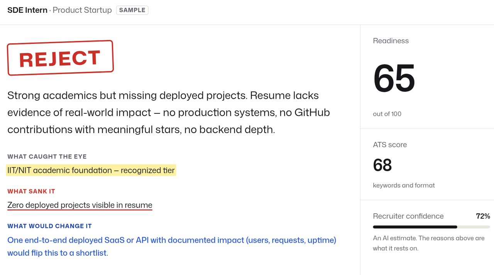
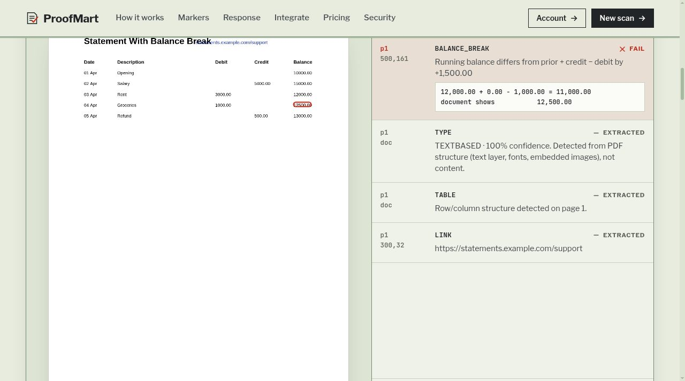

<picture>
  <source media="(prefers-color-scheme: dark)" srcset="assets/header-dark.svg">
  
</picture>

<p align="center">
  <a href="https://cv.143.lat"><b>CV</b></a> &nbsp;·&nbsp;
  <a href="https://deepanshulathar.com"><b>Portfolio</b></a> &nbsp;·&nbsp;
  <a href="https://linkedin.com/in/deepanshulathar"><b>LinkedIn</b></a> &nbsp;·&nbsp;
  <a href="mailto:deepanshu@143.lat"><b>deepanshu@143.lat</b></a>
</p>

> **B.Tech CSE (LPU, 2028) who works in founders' offices and builds the product himself.** Three live products, each with tests or evals you can open below. Looking for an **AI PM / product internship, on-site in Bengaluru, Jan to Jun 2027.**

<picture>
  <source media="(prefers-color-scheme: dark)" srcset="assets/s01-dark.svg">
  
</picture>

<table>
<tr>
<td width="50%" valign="top">

<a href="https://gapl.143.lat"></a>

**[Gapl](https://gapl.143.lat)** · AI resume review that thinks like a recruiter<br>
<sub>`Next.js` `TypeScript` `Firebase` `Razorpay` · live beta, 10+ testers</sub>

- LLM gateway with provider fallback and validated output
- Eval found a false-rejection bug: **41/44 → 44/44** after the fix

**Proof →** [eval report](https://github.com/latharrr/gapl/blob/master/evals/EVAL_REPORT.md) · [repo](https://github.com/latharrr/gapl)

</td>
<td width="50%" valign="top">

<a href="https://proofmart.shop"></a>

**[ProofMart](https://proofmart.shop)** · re-adds bank statements to catch edits<br>
<sub>`Next.js` `TypeScript` `Supabase` `OCR`</sub>

- No AI in the verdict: deterministic checks, each pinned to page coordinates
- Signed results anyone can verify; public API and CLI

**Proof →** [28 unit + 4 E2E test files](https://github.com/latharrr/Proofmart.shop/tree/main/web/tests) · [repo](https://github.com/latharrr/Proofmart.shop)

</td>
</tr>
<tr>
<td width="50%" valign="top">

<a href="https://tv.143.lat"></a>

**[LPU Connect](https://tv.143.lat)** · anonymous campus chat and video<br>
<sub>`React` `Node.js` `Socket.IO` `WebRTC`</sub>

- **10,000 concurrent users, 0 failures** in a load test on the live server
- 47 backend tests (~84% coverage); messages are never stored

**Proof →** [load test report](https://github.com/latharrr/lpuconnect/blob/main/docs/LOADTEST.md) · [tests](https://github.com/latharrr/lpuconnect/tree/main/backend/test)

</td>
<td width="50%" valign="top">

<picture>
  <source media="(prefers-color-scheme: dark)" srcset="assets/dandiya-dark.svg">
  
</picture>

**Dandiya Nights** · PicaPool's Navratri partner-matching app<br>
<sub>Product owner, end to end</sub>

- Onboarding, swipe pacing, referral bonuses, cross-promo into PicaPool
- Funnel tracked daily: visitor → OTP → profile

**Proof →** company product, private repo · walkthrough on request

</td>
</tr>
</table>

<picture>
  <source media="(prefers-color-scheme: dark)" srcset="assets/s02-dark.svg">
  
</picture>

| | |
|---|---|
| **PicaPool** · Founder's Office <br><sub>Delhi · Jul 2025 to present</sub> | **15+ internal tools in 8 weeks** (CRM, WhatsApp API dashboard, attribution). Event-level attribution for a campaign reaching **3,000+ students**. |
| **UniLyf** · Product & Growth <br><sub>UK, remote · Jan to May 2026</sub> | Found the actions behind Day-7 retention in a 0-to-1 beta; led a team of 6; **100K+ monthly views** pre-launch. |
| **LPU Student Organisations** <br><sub>Mar 2025 to present</sub> | Promoted to HR Coordinator in 4 months. **225+ organisations, 30+ campus events.** |
| **Freelance** · Web & Growth <br><sub>Jun 2025 to Feb 2026</sub> | Paid D2C work, incl. the [Spraykart](https://github.com/latharrr/spraykart) Shopify store. |

<sub>Company metrics come from internal dashboards and are on my <a href="https://cv.143.lat">CV</a>; happy to walk through how each was measured.</sub>

<picture>
  <source media="(prefers-color-scheme: dark)" srcset="assets/s03-dark.svg">
  
</picture>

<p align="center">
  
</p>

**Product** &nbsp; user research · prioritisation · GTM · funnels & cohorts · retention · A/B tests · attribution<br>
**AI** &nbsp; Claude · OpenAI · Gemini · Groq · RAG with pgvector · multi-provider failover · output validation · evals

<details>
<summary><b>How I build</b></summary>

```yaml
start_with:    user behaviour, not a feature list
before_launch: instrument the funnel, or it didn't happen
ai_features:   fallback providers, validated output, an eval set
trust:         signed outputs, verified webhooks, least-privilege queries
done_means:    deployed, measured, and someone actually used it
```

</details>

<p align="center">
  <sub>B.Tech CSE, Lovely Professional University, 2024 to 2028 · CGPA 7.15 · McKinsey Forward · Deloitte Data Analytics Simulation</sub><br>
  <a href="mailto:deepanshu@143.lat"><b>Hiring for Jan to Jun 2027? Say hi →</b></a>
</p>
